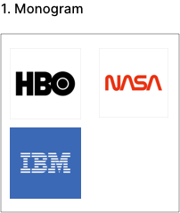
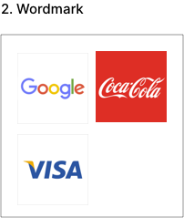
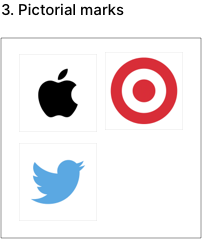
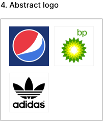
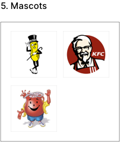
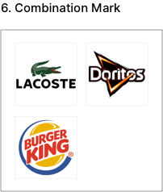
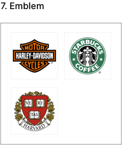
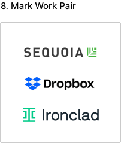
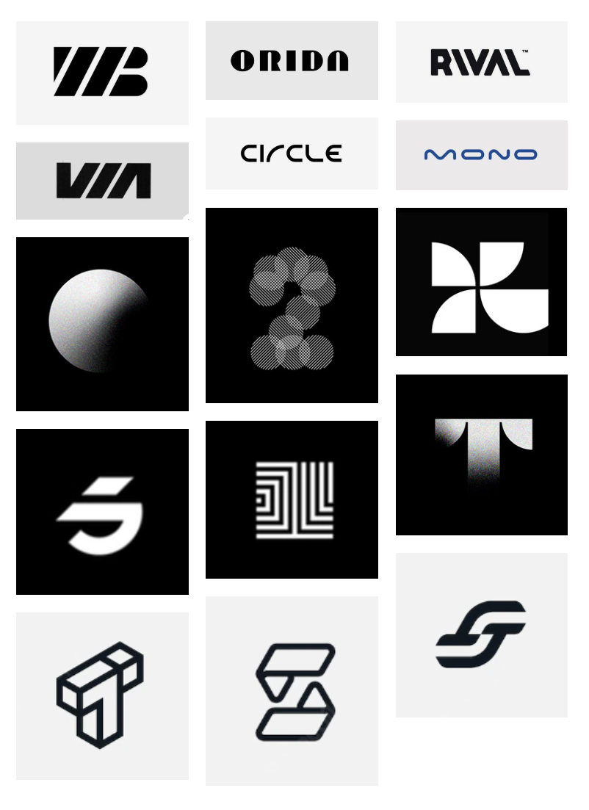

# HMW Brand Identity Creative Brief (reference template)

> Source: Google Doc `1WKDIetWegW5U8PjoIKCuyyqP7WqQtn-xV1rzp3eNz18`, pulled 2026-11-17. This was a previous project (HMW), used here as the **template** for the Wildrock brief.

## A. Basic Info
1. **Company name:** HMW (How might we)
2. **What we do:** a platform to help designers organize and optimize their workflows.
3. **Mission:** Empower designers to be more creative and mentally invested in their work by reducing managerial tasks and excess context switching.
4. **Who we target:** In-house and freelance product designers

## B. Brand Personality
(Full exercise: [workshop.md](workshop.md))
1. **Reassuring**: Abundance · In control · Secure
2. **Experimental**: Detailed · Analytical · Geeky
3. **Vibrant**: Free · Flexible · Adaptable

## C. General Direction: what type of logo?
- 1. Monogram / 2. Wordmark
- 4. Abstract logo
- 8. Word-mark pair

Logo-type reference chart:

| | | | |
|---|---|---|---|
|  |  |  |  |
|  |  |  |  |

## D. Do not try 🚫
- Styles that are too thin
- Styles that are too complicated/intricate

## E. Imagery ideas
- Repeating patterns
- Simple shapes
- Calm
- Nature
- Majestic animals
- Shapes that appear to be changing / in motion

## F. Placement
- App icon
- Website
- T-Shirt

## G. Logomark concept ideas
**Logo:**
- Repeating patterns: abstract shapes, lines, circles
- Creative wordmarks with the letters: hmw (all lowercase), HMW (all caps), or a combination
- Letters set in, on top of, or next to a shape or pattern

**Colors:** Nail a strong logo/wordmark first, then explore colors.

## H. What success looks like
- A wordmark or word-mark pair logo
- A logo that reflects the brand personality traits
- A logo that is bold and simple
- A logo that looks good as a watermark (no color)

## I. Style directions
1. Moodboard: `http://www.gomoodboard.com/boards/LV2zrvAK/share` (**dead link**: the domain no longer resolves as of 2026-11-17)

